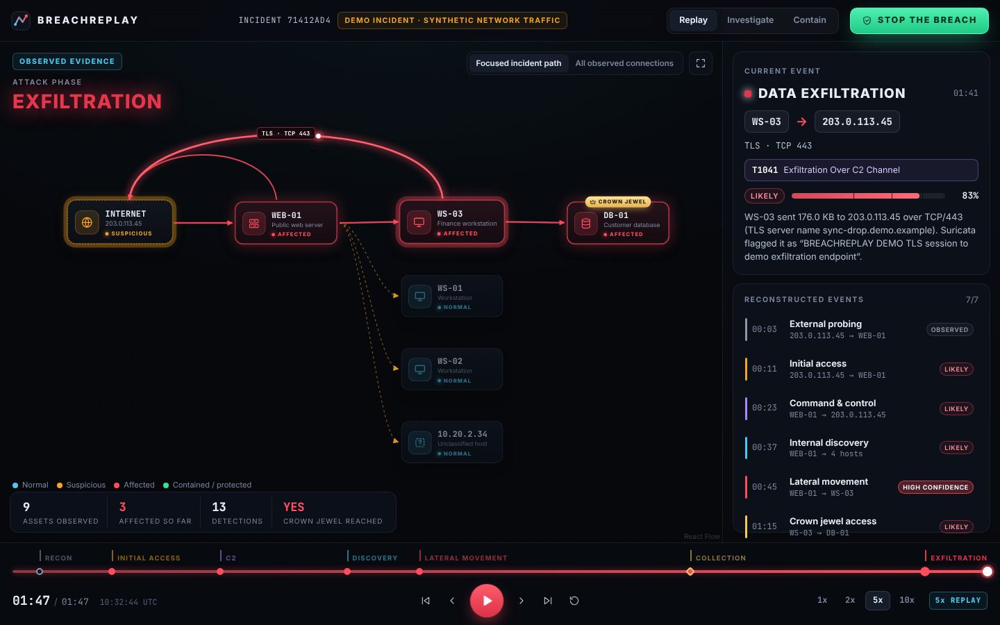
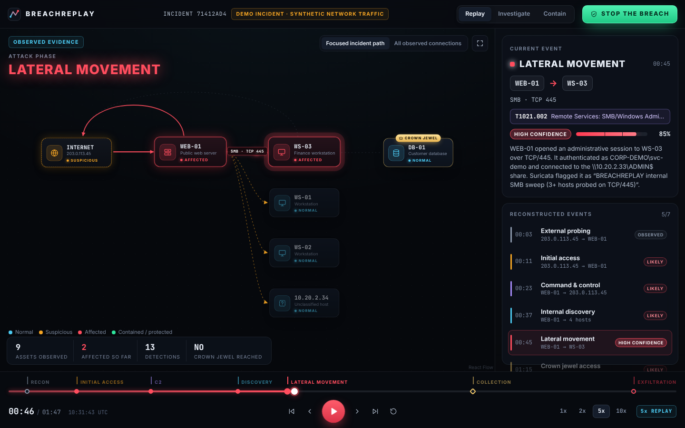
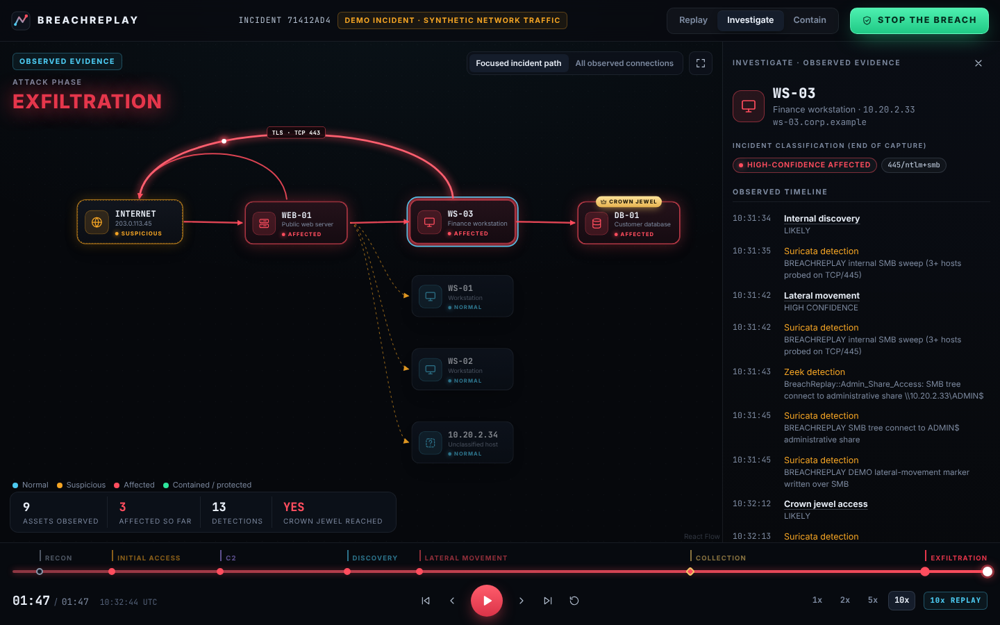
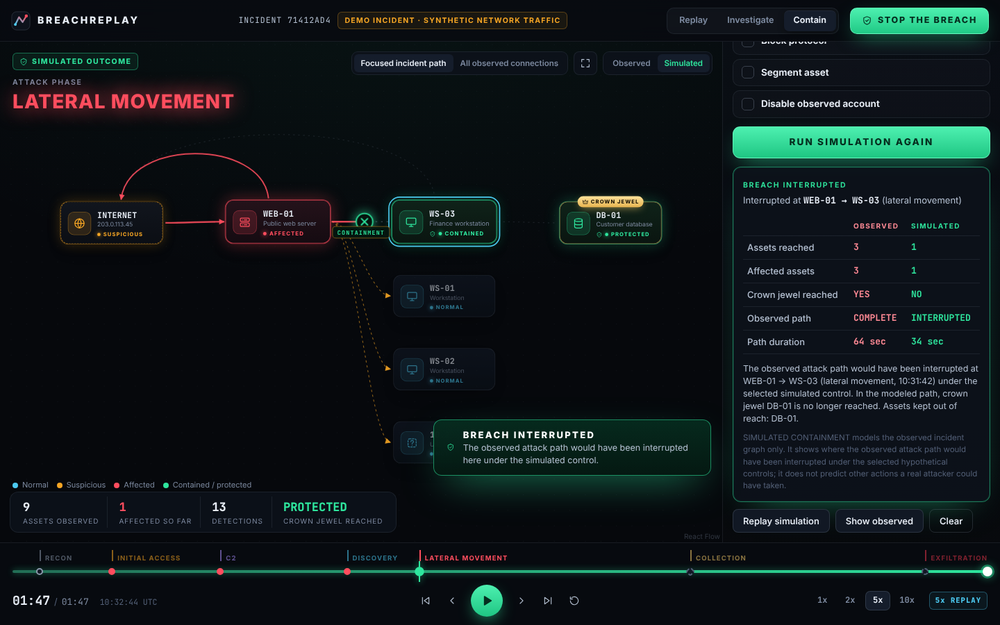
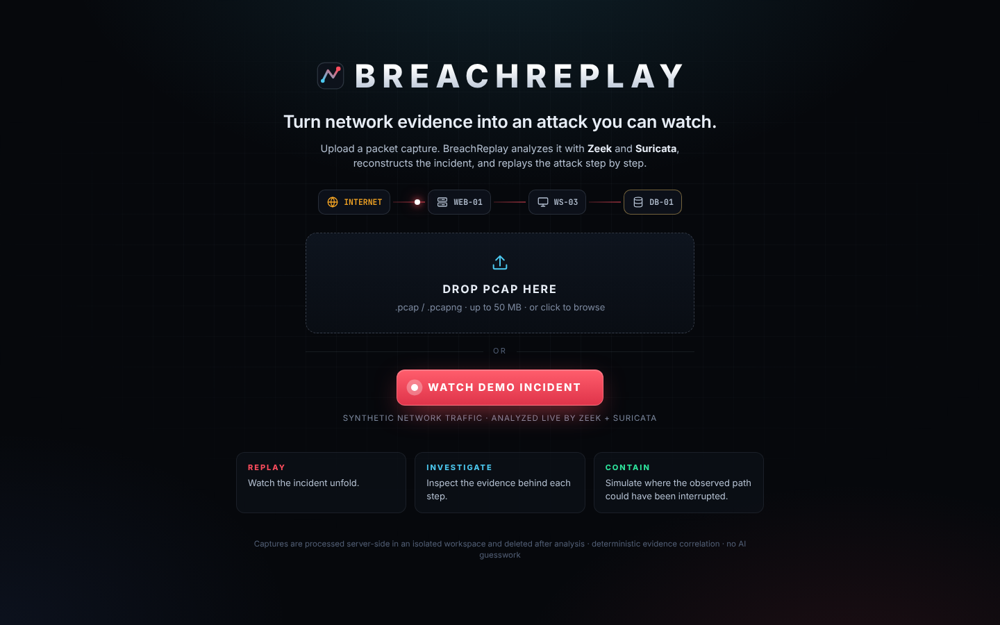
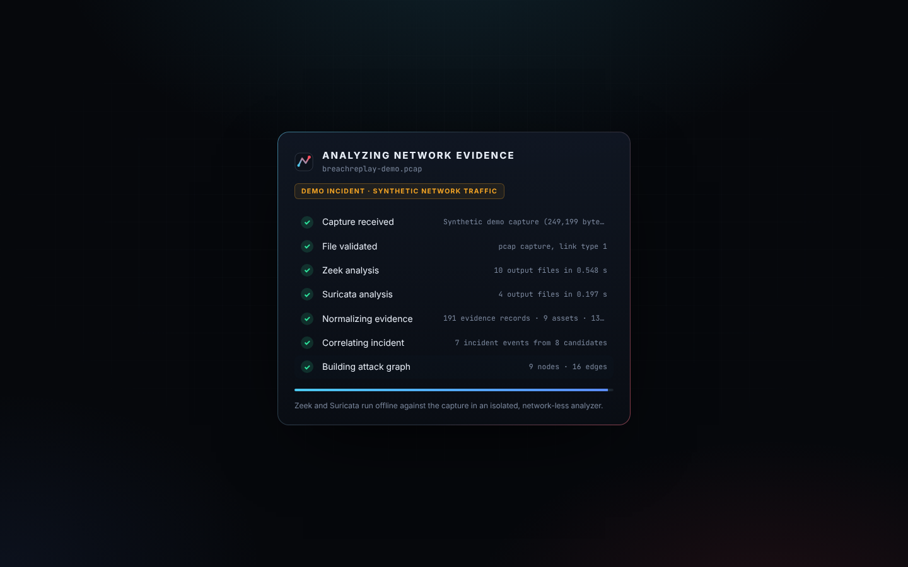
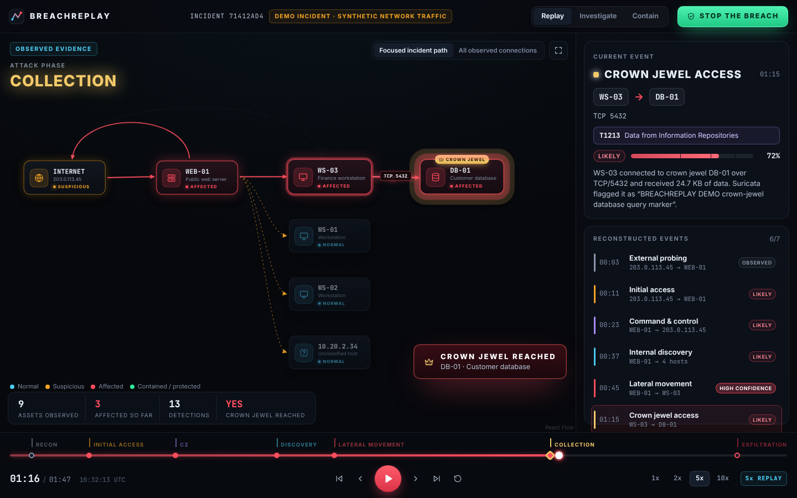
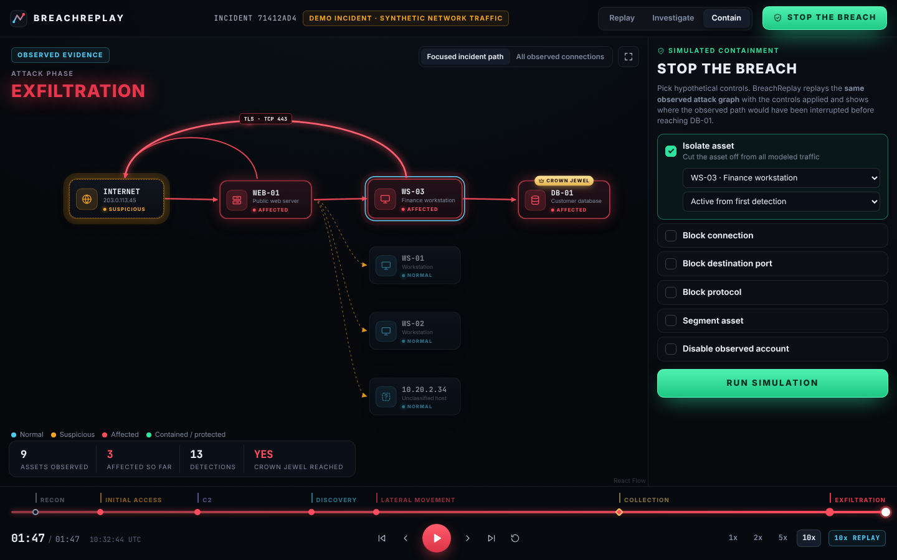
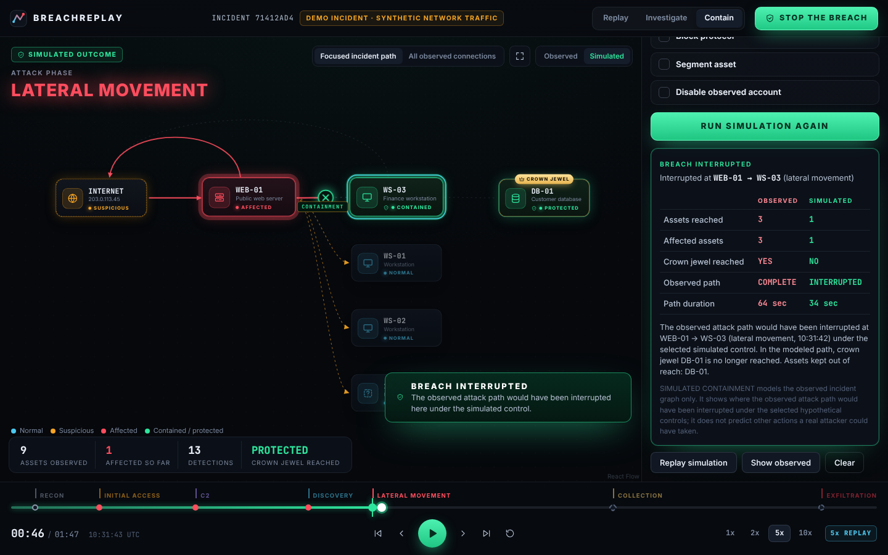
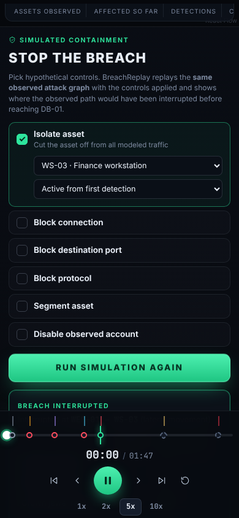

# BreachReplay ⚡

### Turn network evidence into an attack you can watch.


Upload network evidence. BreachReplay analyzes the traffic with **Zeek** and **Suricata**, correlates the evidence into an incident graph, and lets you **replay** the breach, **investigate** each step, and **simulate** where defensive controls would have interrupted the observed attack path.

<table>
<tr>
<td width="33%"><b>REPLAY</b><br/>Watch the incident unfold: systems turn amber and red as the attack moves across the network.</td>
<td width="33%"><b>INVESTIGATE</b><br/>Click any system or connection to see the evidence behind each step and why it was classified that way.</td>
<td width="33%"><b>CONTAIN</b><br/>Press <i>Stop the breach</i>, pick a control, and replay the same incident to see where the observed path is interrupted.</td>
</tr>
</table>

> The demo incident is **synthetic network traffic** generated for this project and analyzed live by the real pipeline. ▶ [Watch the 40-second demo (MP4)](docs/demo/breachreplay-demo.mp4)

---

## See it

| | |
|---|---|
|  |  |
| **The reconstructed incident.** Internet → WEB-01 → WS-03 → crown-jewel DB-01, plus C2, discovery and exfiltration. | **Lateral movement.** SMB with ADMIN$ share access, mapped to ATT&CK T1021.002 at 85% confidence. |
|  |  |
| **Investigate.** Observed timeline, detections, ATT&CK mapping, scoring reasons and raw evidence records. | **Simulated containment.** Isolating WS-03 interrupts the observed path; the crown jewel stays protected. |

<details>
<summary>More screenshots: landing, analysis, crown-jewel moment, containment setup, mobile</summary>

| | |
|---|---|
|  |  |
|  |  |
|  |  |

</details>

---

## Run it

Requirements: Docker with Compose v2, `python3`, `curl`.

```bash
make demo
```

That builds the images, generates the synthetic capture, starts Zeek, Suricata, the API and the web UI, runs the demo capture through the full pipeline, and prints:

| | |
|---|---|
| **BreachReplay** | http://localhost:8080 (click **Watch demo incident**, or drop your own `.pcap`) |
| **API docs** | http://localhost:8000/docs |

`make verify` runs the end-to-end checks against the stack. `make down` stops it.

No Docker? `make showcase` serves the precomputed showcase incident instead (see below).

---

## How it works

```
PCAP / PCAPNG
      │   validated: extension, size, magic bytes, link type
      ▼
┌──────────────────┐        ┌──────────────────┐
│       Zeek       │        │     Suricata     │     offline, read-only, non-root,
│ conn dns http ssl│        │   EVE JSON: alert│     no network access
│ smb ntlm files   │        │   flow http tls  │
│ notice           │        │   dns smb files  │
└────────┬─────────┘        └────────┬─────────┘
         └─────────────┬─────────────┘
                       ▼
              Evidence normalizer        assets, evidence records, detections,
                       │                 per-connection activities
                       ▼
              Correlation engine         deterministic, scored, explainable
                       │
                       ▼
                Incident graph           events, state changes, primary path,
                       │                 crown jewels, ATT&CK mappings
                       ▼
           FastAPI  (REST + WebSocket)
                       │
                       ▼
            React + React Flow UI        replay · investigate · contain
```

1. **Analyzers.** Zeek and Suricata run in their own containers on an internal Docker network with no route to the internet. The API places the capture in a per-job workspace and asks each analyzer to process it. The only input the analyzers accept is a random job id.
2. **Normalization.** Zeek logs (JSON or TSV) and Suricata EVE events are parsed defensively: missing, empty and malformed logs are counted, not fatal. Records become `NetworkEvidence`, alerts and notices become `Detection`s, and everything is grouped per connection (Zeek uid / 5-tuple) into activities. Assets are discovered from traffic, named from DNS answers and NTLM, classified by the services they accept, and optionally enriched with analyst context such as crown jewels.
3. **Correlation.** A transparent rule engine walks activities in time order and proposes incident events (external probing, initial access, C2, discovery, lateral movement, crown-jewel access, exfiltration). Each event is scored from documented evidence weights and gets a label: **OBSERVED**, **SUSPICIOUS**, **LIKELY** or **HIGH CONFIDENCE**, with the reasons. A plain connection with no corroborating signal never rises above OBSERVED.
4. **Graph.** Events drive asset state changes (NORMAL → SUSPICIOUS → AFFECTED). The primary attack path is the earliest chain of access events from the external entry point to the first crown jewel reached.
5. **Replay.** Every frame is a pure function of the incident and the replay time, so scrubbing backwards or forwards always shows the correct state.
6. **Simulation.** Controls (isolate asset, block connection, port or protocol, segment an asset, disable an observed account) are applied to the observed event sequence. The result is a separate object; the incident itself is never modified.

More detail: [ARCHITECTURE.md](ARCHITECTURE.md).

### The demo incident

[`scripts/generate_demo_pcap.py`](scripts/generate_demo_pcap.py) writes a deterministic, synthetic capture: 424 packets, 249,199 bytes, RFC1918 internal hosts and RFC 5737 documentation-range external hosts. It contains baseline traffic plus a controlled incident whose payloads are plain-text markers matched by [project-local Suricata rules](demo/rules/breachreplay-demo.rules). There is no exploit code, malware or real credentials. The NTLM exchange uses a fictional account with empty responses.

What the pipeline measured on it (Zeek 7.0.5, Suricata 7.0.10):

| | |
|---|---|
| Zeek connections | 35 (plus dns, http, ssl, files, smb_mapping, smb_files, ntlm and notice logs) |
| Suricata | 11 alerts, 35 flows, plus dns, http, fileinfo and smb events |
| Normalized evidence | 191 records, 13 detections, 9 assets |
| Incident | 7 events, 16 edges, path Internet → WEB-01 → WS-03 → DB-01 (crown jewel) |
| ATT&CK | T1190, T1071.001, T1046, T1021.002, T1213, T1041 (the external probing event is deliberately not mapped) |

---

## Full mode vs Showcase mode

**FULL MODE** (`make demo`)

```
PCAP → Zeek → Suricata → normalization → correlation → BreachReplay
```

Uploads are enabled and every analysis runs the real tools.

**SHOWCASE MODE** (`make showcase`, or `SHOWCASE_MODE=true`)

```
precomputed, sanitized synthetic incident → immediately viewable demo
```

[`showcase/showcase-incident.json`](showcase/showcase-incident.json) was produced by the full pipeline from the demo capture and exported with internal addresses masked and evidence metadata restricted to an allow-list (`make showcase-export` regenerates it). No analyzers run, uploads are disabled, and the UI labels it **SHOWCASE DEMO · PRECOMPUTED SYNTHETIC INCIDENT**. Replay, investigation, containment simulation and comparison all work exactly as in full mode. This is the mode to host as a public demo.

---

## Security model

- Defensive analysis only: no scanning, exploitation or attack-back functionality.
- Captures are untrusted input: extension, size, magic-byte and link-type validation; generated internal filenames; path-traversal and control-character filenames rejected.
- Analyzers are invoked with argument lists (`shell=False`), timeouts that kill the process group, and a minimal environment.
- Each job gets an isolated workspace that is deleted after analysis. Extracted files are never executed or opened.
- Containers run as non-root (uid 10001 / nginx 101) with read-only root filesystems, all capabilities dropped and `no-new-privileges`. The analyzers sit on an internal network with no egress.
- `PUBLIC_MODE=true` masks internal IPs in API responses. Showcase exports are always sanitized.

Details and reporting: [SECURITY.md](SECURITY.md).

---

## Testing

| Suite | Command | Result (this repository, measured) |
|---|---|---|
| Backend unit + API + WebSocket + real-analyzer integration | `make test-backend` | 128 passed with Zeek/Suricata reachable (127 passed + 1 skipped without them) |
| Frontend unit + component | `make test-frontend` | 47 passed |
| Lint / format / typecheck | `make lint` | ruff clean, ruff format clean, `tsc` clean |
| End-to-end stack checks | `make verify` | 22/22 checks passed (full mode), 18/18 (showcase mode) |
| Browser E2E (Playwright, production build behind nginx) | `make e2e` | 3 passed |

The backend tests run against **real recorded Zeek and Suricata output** for the demo capture ([fixtures](backend/tests/fixtures/demo-analysis)). An integration test re-runs the real analyzers whenever they are reachable, and CI runs the whole Docker pipeline plus Playwright on every push.

---

## Tech stack

**Analysis:** Zeek 7.0.5 · Suricata 7.0.10 · custom Zeek policy and Suricata rules
**Backend:** Python 3.12 · FastAPI · Pydantic v2 · asyncio · WebSockets · pytest · ruff
**Frontend:** React 19 · TypeScript · Vite · React Flow (@xyflow/react) · Framer Motion · Zustand · Vitest · Testing Library
**Infrastructure:** Docker · Docker Compose (internal analyzer network) · nginx · GitHub Actions · Playwright

```
backend/     FastAPI app: analyzers, parsers, normalization, correlation, mitre, graph, simulation, api
analyzer/    Zeek and Suricata worker images + Zeek policy
frontend/    React app: graph, replay, investigate, containment, upload; e2e/ Playwright
demo/        Suricata demo rules, asset context; generated/ (capture, git-ignored)
showcase/    Sanitized precomputed incident
scripts/     generate_demo_pcap.py, export_showcase.py, demo.sh, verify.sh
docs/        screenshots, demo recording, architecture notes
```

---

## Limitations

- Correlation is rule-based and tuned on the synthetic scenario. It recognises common network patterns (web attack signatures, beaconing, sweeps, admin protocols, crown-jewel access, large outbound transfers), but it is not a general detection product and has not been evaluated on real-world incident datasets, so no accuracy figures are claimed.
- Detection depth depends on the Suricata rules supplied. The project ships safe demo rules, not a commercial or ET ruleset.
- Encrypted traffic is analyzed from metadata only (TLS SNI, sizes, timing).
- Simulation models the **observed** path. It shows where that path would have been interrupted; it cannot predict how an attacker would have adapted.
- Incidents are kept in memory (bounded LRU). There is no authentication or multi-user persistence; run it locally or behind your own access control.
- Very large captures are bounded by the upload limit and analyzer timeouts rather than streamed.

## Roadmap

- Static-hosted showcase (client-side simulation) for zero-backend public demos
- Optional Emerging Threats ruleset profile and Zeek package support
- Host and identity evidence (EDR, Windows events) alongside network evidence
- Persistent case storage and analyst annotations
- Evaluation against public, labeled incident captures

## License

[MIT](LICENSE)
