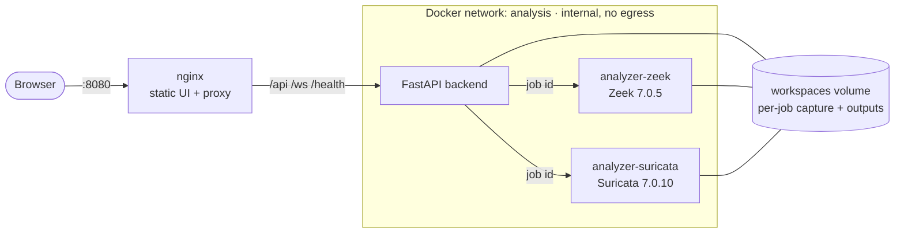
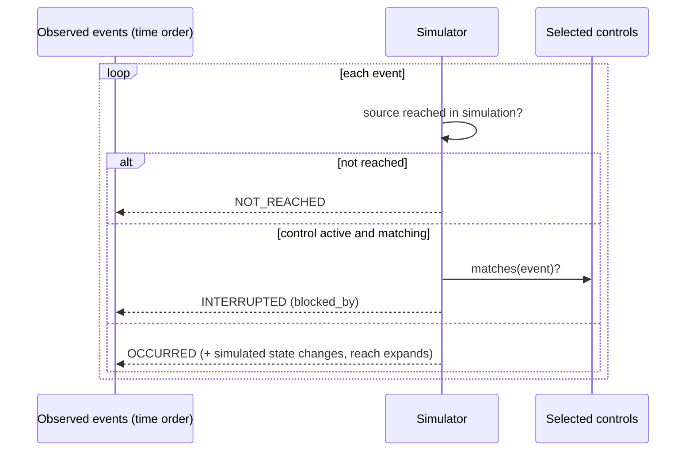

# Architecture diagrams

See [ARCHITECTURE.md](../../ARCHITECTURE.md) for the full description.

## Runtime topology



## Analysis pipeline

```mermaid
flowchart TD
  pcap[PCAP / PCAPNG] --> val[Validation<br/>extension · size · magic · link type]
  val --> ws[Isolated workspace]
  ws --> zeek[Zeek offline<br/>conn dns http ssl files smb ntlm notice]
  ws --> suri[Suricata offline<br/>EVE alert flow http tls dns smb fileinfo]
  zeek --> norm[Normalization<br/>assets · evidence · detections · activities]
  suri --> norm
  norm --> corr[Correlation engine<br/>candidates · weighted signals · labels · reasons]
  corr --> mitre[ATT&CK mapping<br/>evidence-gated]
  corr --> graph[Incident graph<br/>edges · state changes · primary path · crown jewels]
  mitre --> graph
  graph --> api[REST + WebSocket]
  api --> ui[Replay · Investigate · Contain]
  graph --> sim[Containment simulation<br/>separate SimulationResult]
  sim --> api
```

## Simulation semantics


